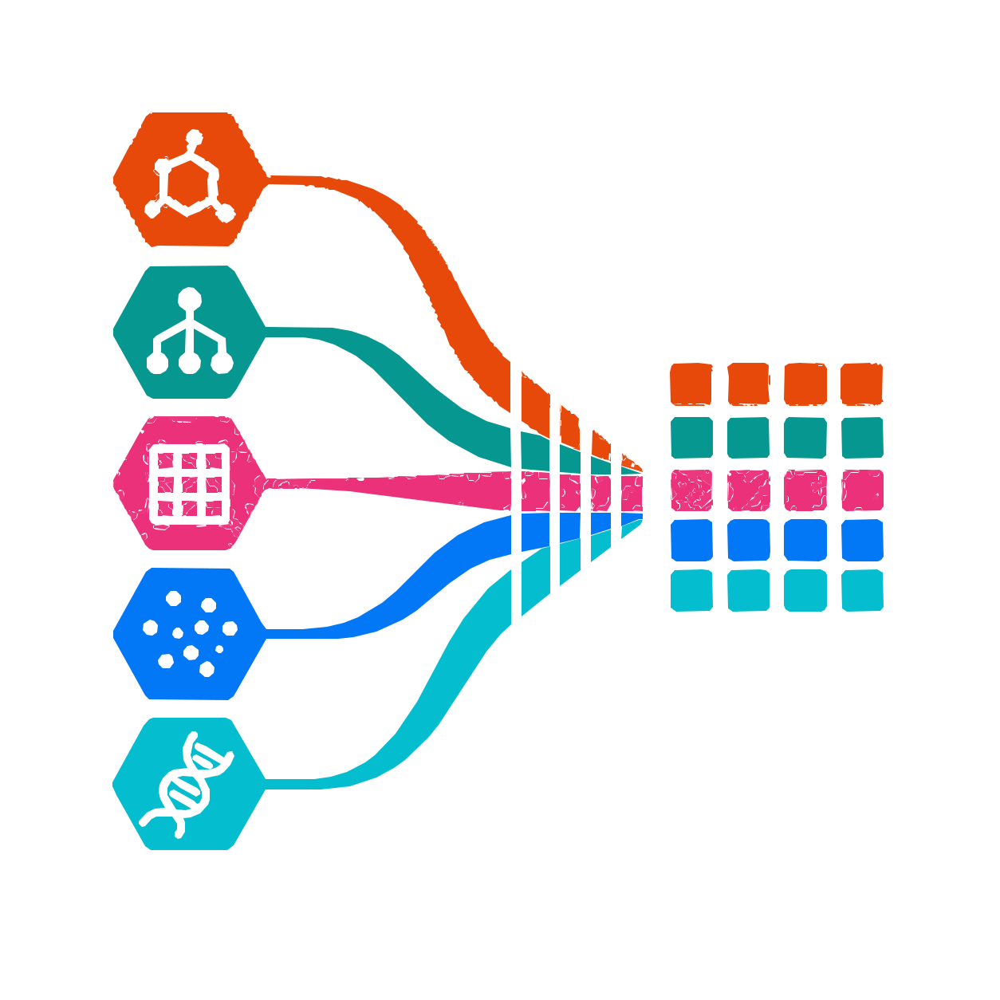

# 🦞 providence



**providence** is a Python package for reproducible dataset loading and source tracking. Load a local table or a Hugging Face dataset, record where it came from, and save a checkpoint that can reload the same data.

Use Providence to load data before splitting it with [Eluent](https://github.com/scbirlab/eluent) or computing features with [Aspect](https://github.com/scbirlab/aspect). You can also checkpoint a split or feature table you already have.

## Installation

Providence requires Python 3.11 or later. To install from GitHub, run:

```bash
python -m pip install 'git+https://github.com/scbirlab/providence.git'
```

## Python

`DataResolver` accepts local files such as CSV, TSV, and Parquet, as well as pandas DataFrames, dictionaries of columns, and Hugging Face datasets. The loaded Hugging Face dataset is available as `.data`, and `.data_source` holds its source metadata.

```python
from providence import DataResolver

resolved = DataResolver("measurements.csv")
resolved.save("measurements.checkpoint")

restored = DataResolver.load("measurements.checkpoint")
print(restored.data.num_rows)
print(restored.data_source.to_config())
```

By default, `save()` embeds local or in-memory data as Parquet. The checkpoint stores a SHA-256 checksum and verifies the embedded file on reload. For a local file that will remain available at its original path, use `save_source_data=False` to save a reference and verify the source file when you reload.

## Command line

Use `providence get` to write a checkpoint, export a table, or do both:

```bash
providence get measurements.csv --checkpoint measurements.checkpoint --output measurements.parquet
```

The CLI saves a source reference by default. Add `--force-write-data` to embed the table in the checkpoint.

For Hub datasets, use `hf://datasets/OWNER/DATASET`. Append `@REVISION`, `~CONFIG`, and `:SPLIT` as needed. For example:

```bash
providence get 'hf://datasets/stanfordnlp/imdb@main:train' --checkpoint imdb-train.checkpoint
```

Providence resolves the requested Hub revision to a commit SHA and records the pinned reference in the checkpoint. Reloading that checkpoint uses the recorded commit even if the branch has moved.

## Issues, problems, suggestions

Please [open an issue on GitHub](https://github.com/scbirlab/providence/issues).

## License

[MIT](LICENSE)
